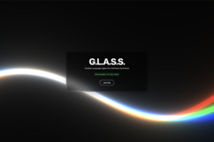
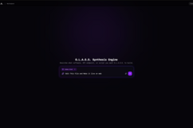
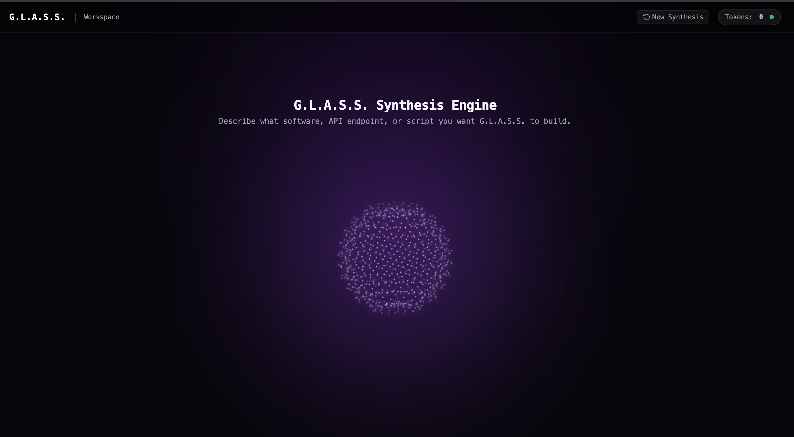
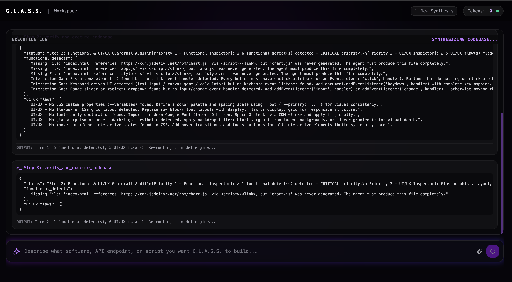
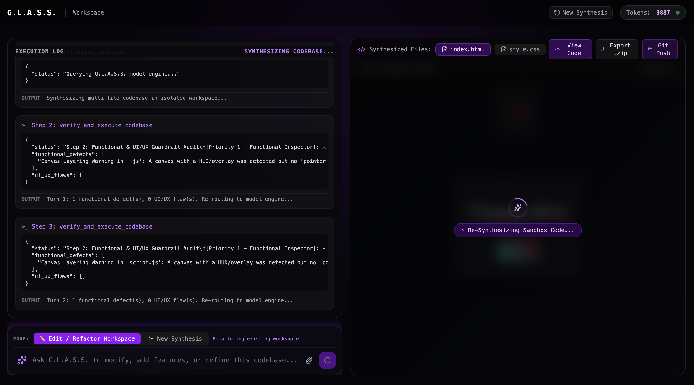
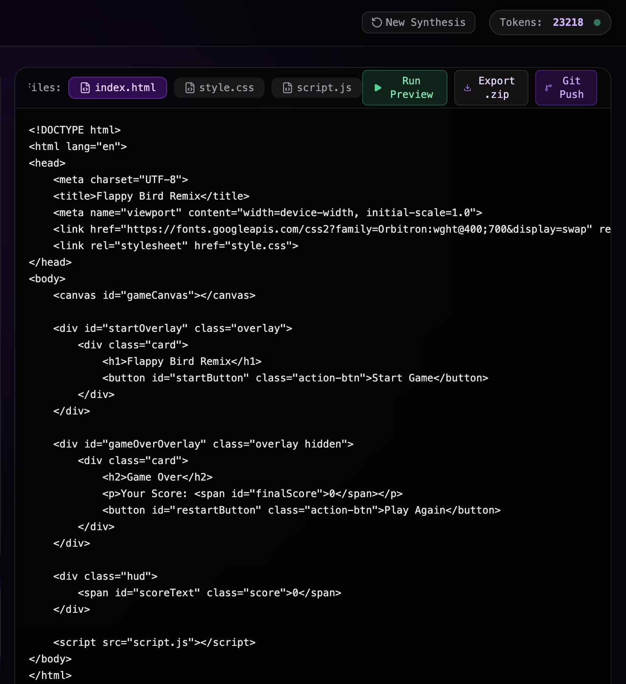
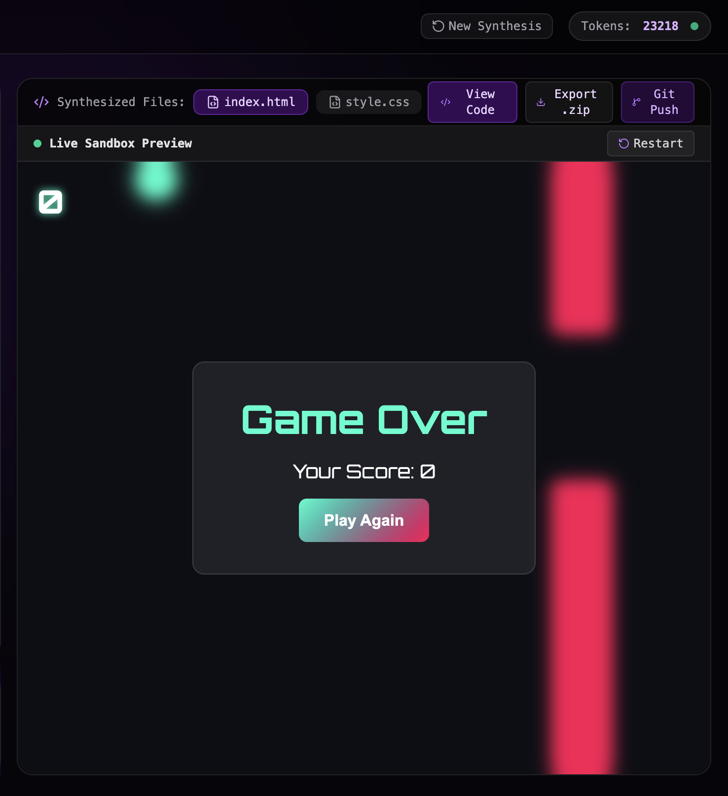
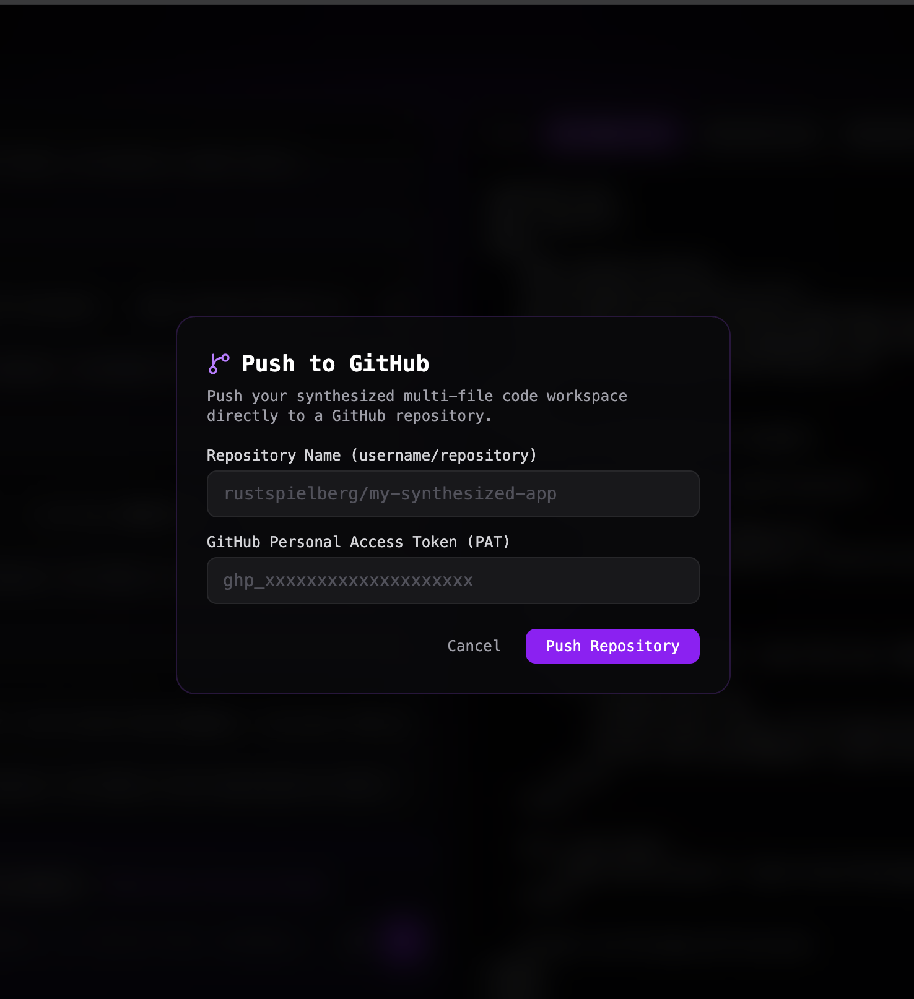

# G.L.A.S.S. | Guided Language Agent for Software Synthesis

[](https://g-l-a-s-s.vercel.app)
[](https://nebius.ai)
[](https://nvidia.com)

> **G.L.A.S.S. (Guided Language Agent for Software Synthesis)** is an autonomous, end-to-end software synthesis pipeline designed to turn complex natural language specifications into verified, modular, multi-file software applications with real-time in-browser execution.

---

## 📸 Complete Visual Walkthrough & System Workflow

Below is the step-by-step UI/UX operational flow of G.L.A.S.S., mapping out each phase from initial landing to automated GitHub deployment.

### 1. Hero Landing Page
The entry point of G.L.A.S.S. features a high-aesthetic dark glassmorphism portal driven by dynamic radial background lighting and a central glowing white orb. It establishes system availability ("Available for New Tasks") and provides a single, high-impact initiation button ("Let's Go") to launch the synthesis engine.


### 2. Primary Workspace (Playground #1)
The primary prompt intake canvas where developers specify application architecture, feature sets, layout choices, and framework requirements. Designed for high-clarity prompt entry before initiating the background agent pipeline.


### 3. Mind Orb Loading State (Enforced 5s UI/UX Feedback State)
To give users and screen recordings immediate visual feedback during heavy AI reasoning, the system locks into a minimum 5-second central glowing "Mind Orb" state. While the animation plays, the backend initiates multi-file architectural planning and token buffering in the background before transitioning to execution logs.


### 4. Execution Hub Terminal (Real-Time Agentic Logging)
A low-latency streaming terminal log interface that displays step-by-step backend operations in real-time (`Step 1: synthesize_codebase`, `Step 2: verify_and_execute_codebase`). Users witness code assembly, file separation, static AST checks, and guardrail validations live.


### 5. Secondary Workspace (Playground #2)
The active development hub that maintains chat history, current token consumption counts, execution status, and a dedicated edit bar at the bottom left for iterative prompting and continuous code refinement.


### 6. Multi-File Code Editor View
A tabbed code inspector displaying clean, modular code output. Rather than clumping code into monolithic scripts, G.L.A.S.S. separates logic across structured files (`index.html`, `styles.css`, `app.js`, `.py`, `.cpp`), complete with syntax highlighting and cross-file reference mapping.


### 7. Live Sandbox Preview Window
An isolated client-side iframe execution sandbox. The moment code generation and verification finish, `.html` web applications compile dynamically into the preview window for instant zero-latency interaction, game loop testing, and visual audit.


### 8. GitHub Automation & Deployment Window
The source control integration panel allowing developers to push synthesized multi-file codebases straight to GitHub repositories or export raw project archives for local terminal execution.


---

## ⚡ Core Architecture & Technical Breakthroughs

* **Upgraded Token Output Window (8,192 Tokens):** Upgraded from the initial 4,096 token limit to a massive **8,192 output token limit**, allowing G.L.A.S.S. to synthesize **800 to 1,000+ lines of production-ready code** per single turn without truncation or truncated syntax errors.
* **Dual-Inspector Guardrail System (Self-Healing Loop):**
  * **Priority 1 — Functional & Bug Inspector (Top Priority):** Runs static analysis, checking for syntax errors, missing dependencies, canvas layering traps, unclosed tags, and runtime scope errors. Code logic integrity is strictly enforced first.
  * **Priority 2 — UI/UX Guardrail Agent:** Evaluates visual layout quality, enforcing clean typography scales, CSS grid/flexbox responsiveness, custom dark mode glassmorphism themes, and interactive hover/focus states over unstyled browser defaults.
  * **Self-Healing Loop:** If a defect is caught by either inspector, G.L.A.S.S. automatically re-routes full code context back to the model engine for autonomous patching on Turn 1 before delivering final code to the client sandbox.
* **Multi-File Modular Synthesis:** Generates scalable web architectures by maintaining clean separation of concerns across `.html`, `.css`, and `.js` files. Non-HTML scripts (`.py`, `.cpp`) generate with structured unit logic for local terminal execution.
* **Live In-Browser Execution Sandbox:** Features an embedded client-side iframe sandbox with instant compilation, enabling instant execution of WebGL, Three.js 3D scenes, HTML5 Canvas games, and Web Audio API synthesisers.

---

## 🤖 Multi-Model Inference Engine & AI Infrastructure

G.L.A.S.S. leverages a high-throughput, multi-model agentic orchestration pipeline powered by **Nebius AI Cloud**, **NVIDIA Open Model Infrastructure**, and open-weights LLM providers:

1. **NVIDIA API Infrastructure:** Ultra-low latency API endpoint routing for high-throughput streaming and rapid generation turnarounds.
2. **Nebius AI Cloud Token Factory:** Cloud GPU infrastructure optimized for high-throughput token streaming and dynamic multi-file generation.
3. **OpenAI GPT-OSS (120B Parameters):** Open Mixture-of-Experts (MoE) model utilized for high-level software planning, multi-file architecture breakdown, and complex logic orchestration.
4. **Qwen 2.5 Coder (32B Instruct):** Primary high-performance code generation backbone trained on 5.5T tokens, matching SOTA proprietary coding benchmarks across 92 languages.
5. **DeepSeek AI / Qwen 2.5 Coder (7B Instruct):** Lightweight, high-speed secondary inspector model used for rapid static code analysis and low-latency bug remediation loops.
6. **Ollama Engine:** Local inference integration layer enabling local private LLM execution on Apple Silicon / private hardware.

---

## 🌐 Live Deployment & Hosted Infrastructure

| Component | Provider | Live Status | Link |
| :--- | :--- | :--- | :--- |
| **Frontend UI** | Vercel | **Live & Public** | [https://g-l-a-s-s.vercel.app](https://g-l-a-s-s.vercel.app) |
| **Backend API** | Render Cloud | **Live Engine** | Powered via Render API |

> **Note on Accessibility & Uptime:** 
> * **Frontend:** Hosted on Vercel with Deployment Protection turned OFF for instant public testing.
> * **Backend Keep-Alive System:** Equipped with automated 5-to-10 minute HTTP ping cron tasks via `cron-job.org` to keep the backend warm, eliminating idle cold starts.

---

## 💡 How to Test & Prompt G.L.A.S.S.

To get clean, production-grade output, paste structured, multi-requirement prompts or use an AI assistant (ChatGPT, Claude, Gemini) to write comprehensive spec prompts.

### What G.L.A.S.S. Synthesizes Best:
* **3D WebGL / Three.js Apps:** Solar system orbiters, particle fields, cyberpunk HUDs, product configurators.
* **Interactive 2D Canvas Games:** Flappy Bird, Space Shooters, Arcade Physics Engine, Retro Platformers.
* **Web Audio API Workstations:** Subtractive synthesizers, 16-step sequencers, FFT frequency spectrum visualizers.
* **Minimalist Analytical Dashboards:** Swiss-style data visualizers, Chart.js metric suites, paginated tables with native Blob CSV export.

---

## 🛠️ Local Development Setup

### Prerequisites
* **Node.js** v18+ & **npm**
* **Git**

### 1. Clone the Repository
```bash
git clone [https://github.com/rustspielberg/g-l-a-s-s.git](https://github.com/rustspielberg/g-l-a-s-s.git)
cd g-l-a-s-s


cd frontend
npm install
npm run dev


**Distributed under the MIT License. Built for the Nebius x NVIDIA Global AI Hackathon.**